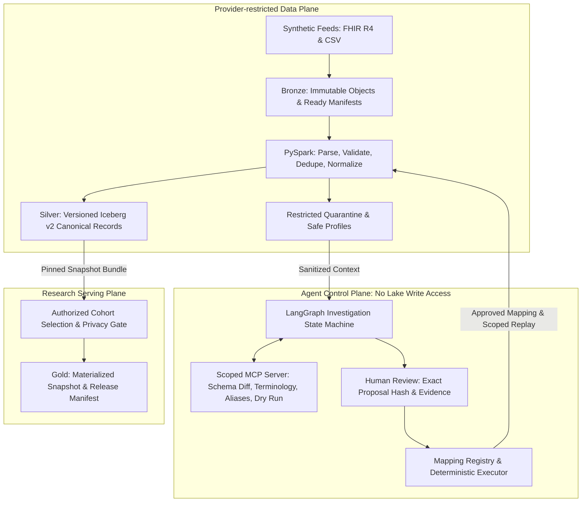

# CareFlow Atlas

> **A replayable healthcare ETL platform that turns heterogeneous synthetic provider feeds into reproducible research datasets.**

A governed AI agent investigates unfamiliar terminology and schema anomalies using scoped tools and proposes typed mappings. Human reviewers authorize exact artifacts by cryptographic hash. Deterministic services validate, transform, replay, and publish.

---

## Central Architecture Proposition

> **Probabilistic investigation belongs in a bounded control plane; clinical transformation, authorization, and publication remain explicit platform contracts.**



---

## Key Invariants

1. **No Unreviewed Semantic Mappings:** Every new mapping proposal requires explicit human approval by exact artifact hash (`proposal_hash`).
2. **Deterministic Processing:** Batch processing uses zero per-record model calls. Approved mappings are compiled to deterministic DSL rules.
3. **Conservation Invariant:** 
   $$\text{N\_input} = \text{N\_accepted} + \text{N\_duplicate} + \text{N\_quarantined} + \text{N\_intentionally\_excluded}$$
4. **Reproducible Releases:** Multi-table releases bind immutable Iceberg snapshot IDs into an attributable release manifest bundle (`StudyRelease`). Direct queries against table `latest` pointers are prohibited in research workflows.
5. **No PHI in Telemetry:** Audit events strictly forbid clinical payloads and patient identifiers.

---

## Technology Stack (Phase 0 Locked Versions)

| Layer | Component | Version / Artifact |
| :--- | :--- | :--- |
| **Language** | Python | `3.11.14` (managed via `uv`) |
| **Batch Engine** | PySpark | `3.5.3` |
| **Java Runtime** | OpenJDK | `17.0.7 LTS` |
| **Table Format** | Apache Iceberg | Format v2 (`iceberg-spark-runtime-3.5_2.12:1.6.1`) |
| **Catalog** | PostgreSQL JDBC Catalog | `postgresql:42.7.3` on `postgres:16-alpine` |
| **Object Store** | MinIO S3 | `minio/minio:latest` (with `iceberg-aws-bundle:1.6.1`) |
| **Contracts** | Pydantic | `2.14.2` |
| **Testing** | pytest & Hypothesis | `pytest 9.2.0`, `hypothesis 6.170.14` |

---

## Quickstart & Local Interface

### Prerequisites
- macOS or Linux with **Docker Desktop** installed and running.
- **Java 17 LTS** (`java -version`).
- **uv** package manager (`curl -LsSf https://astral.sh/uv/install.sh | sh` or `brew install uv`).

### Canonical Commands

```bash
# 1. Bootstrap Python 3.11 virtual environment & dependencies
make bootstrap

# 2. Start PostgreSQL 16 & MinIO containers and create initial buckets
make up

# 3. Run contract invariant and security test suite
make test-contracts

# 4. Run PySpark + Apache Iceberg write/merge/snapshot smoke test
make smoke

# 5. Stop local infrastructure without deleting data volumes
make down
```

---

## Repository Structure

```
careflow-atlas/
├── apps/                    # User-facing applications (API, Console)
├── services/                # Control plane services (Agent, MCP tools, Executor)
├── pipelines/
│   ├── spark/               # Batch transformation jobs & smoke tests
│   ├── adapters/            # Ingestion adapters (FHIR, CSV)
│   └── dags/                # Airflow workflow DAGs
├── packages/
│   ├── contracts/           # Pydantic data models & explicit errors
│   ├── configuration/       # Layered configuration & provider policies
│   ├── mapping-dsl/         # Declarative mapping DSL interpreter
│   └── telemetry/           # OpenTelemetry spans & audit loggers
├── fixtures/                # Synthetic data fixtures & mutation suites
├── evaluations/             # Agent benchmarking test cases & baselines
├── tests/                   # Contract, unit, integration, and security tests
├── infrastructure/compose/  # Docker Compose, PostgreSQL schema init, MinIO
├── docs/                    # Master spec, ADRs, runbooks, status
├── Makefile                 # Canonical CLI target interfaces
└── pyproject.toml           # Locked dependencies & tool settings
```

---

## Implementation Status

- [x] **Phase 0:** Compatible locked stack, typed contracts, local infrastructure, Iceberg v2 write/merge/snapshot smoke test.
- [ ] **Phase 1:** Single synthetic FHIR provider (Patient, Encounter, Observation), canonical persistence, duplicate-safe replay.
- [ ] **Phase 2:** Agent investigation control plane, scoped MCP server, human approval workflow, scoped replay.
- [ ] **Phase 3:** CSV adapter, clinical updates/deletes, source ordering convergence, schema drift.
- [ ] **Phase 4:** Isolation tests, approval mutation defense, controlled export gateway, React console.
- [ ] **Phase 5:** Crash recovery, benchmark evaluation against 3 baselines, shadow migration.
- [ ] **Phase 6:** Complete portfolio package, runbooks, demo recording.

See [`docs/implementation-status.md`](docs/implementation-status.md) for detailed progress.
