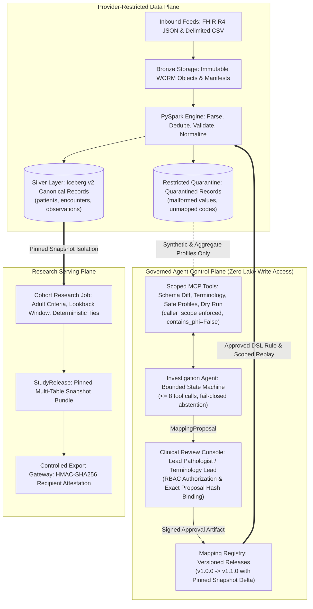

# CareFlow Atlas

[](https://www.python.org/downloads/)
[-teal.svg)](https://iceberg.apache.org/)
[](https://spark.apache.org/)
[](https://www.postgresql.org/)
[](https://min.io/)
[](tests/)
[](docs/threat-model.md)
[](LICENSE)

> **A replayable healthcare ETL lakehouse that turns heterogeneous EHR feeds into reproducible clinical research datasets through a governed AI agent control plane.**

CareFlow Atlas resolves the core challenge of modern healthcare data engineering: **rapid terminology normalization without compromising clinical governance or data privacy**. When unfamiliar clinical codes (e.g. non-standard hospital lab labels) or schema evolutions arrive, a bounded AI agent investigates the anomaly using privacy-preserving aggregate profiles (`contains_phi=False`) and synthesizes an allowlist DSL mapping proposal. Human reviewers authorize exact artifacts by cryptographic SHA-256 hash. Deterministic batch services validate, transform, replay, and publish versioned research releases.

---

## 1. Central Architecture Proposition

> **Probabilistic investigation belongs in a bounded, privacy-preserving control plane; clinical data transformation, authorization, replay, and publication remain explicit, deterministic platform contracts.**



---

## 2. Inbound Anomaly & Investigation Lifecycle

When an unfamiliar lab label (e.g. `LOCAL_LAB_017` with comma-decimal representation `"12,5"`) arrives:
1. **Deterministic Ingestion:** Valid patient/encounter records merge into Silver; the unreviewed observation is safely diverted to `careflow_quarantine` with attributable findings.
2. **Investigation:** The AI agent activates its state machine, querying only **payload-free aggregate profiles** and approved terminology dictionaries.
3. **Proposal:** The agent emits a deterministic `MappingProposal` with an exact SHA-256 hash.
4. **Human Gate:** An authorized clinical pathologist reviews the dossier in the terminal console and signs an immutable `Approval` artifact.
5. **Scoped Replay:** Only the quarantined scope is reprocessed and drained into Silver. Zero lake-wide rescans; zero duplicate rows.

```mermaid
sequenceDiagram
    autonumber
    actor EHR as Healthcare Provider Feed
    participant Ingest as Manifest & Ingestion Service
    participant Lake as Apache Iceberg v2 (Silver & Quarantine)
    participant Agent as Investigation Agent & Scoped Tools
    actor Reviewer as Clinical Pathologist / Reviewer
    participant Registry as Mapping Registry
    participant Replay as Scoped Replay Executor
    participant Research as Cohort Release Service

    EHR->>Ingest: Ingest Batch (Clean Patients + Unfamiliar Lab)
    Ingest->>Lake: Atomic MERGE: Accepted -> Silver; Unmapped -> Quarantine
    Lake-->>Agent: Trigger Anomaly Alert (Scope: LOCAL_LAB_017)
    loop Bounded Investigation (<= 8 tool calls)
        Agent->>Agent: Query Schema Diff, Approved Dictionaries & Zero-PHI Profile
        Agent->>Agent: Dry Run Sandboxed DSL (100% conversion pass)
    end
    Agent->>Reviewer: Submit MappingProposal (Target: 2345-7, Op: parse_decimal, Hash: abe536...)
    Reviewer->>Reviewer: Inspect Statistical Dossier via Review Console
    Reviewer->>Registry: Sign Approval Artifact (RBAC Verified, Exact Hash Bound)
    Registry->>Registry: Promote Catalog Version (v1.0.0 -> v1.1.0)
    Registry->>Replay: Trigger Scoped Replay for Provider Scope
    Replay->>Lake: Merge Mapped Observation into Silver & Drain from Quarantine
    Replay->>Research: Publish New StudyRelease (Pinned Snapshot Delta)
    Note over Lake,Research: Repeat execution drains 0 records (Strict Idempotency Proven)
```

---

## 3. Core System Invariants

1. **No Unreviewed Semantic Mappings:** No probabilistic output from an LLM can execute against clinical data without human authorization bound to the exact cryptographic SHA-256 hash of the proposal.
2. **Zero PHI in Agent Control Plane:** The agent only ever inspects aggregate distributions, distinct sample formats, and vocabulary catalogs (`contains_phi=False`). No patient names, MRNs, dates of birth, or individual identifiers enter prompts.
3. **Deterministic Execution:** Transformations are compiled into an allowlist domain-specific language (`parse_decimal`, `map_approved_code`, `convert_approved_unit`). Arbitrary code and raw SQL generation are forbidden.
4. **Conservation Invariant:**
   $$\text{N}_{\text{input}} = \text{N}_{\text{accepted}} + \text{N}_{\text{duplicate}} + \text{N}_{\text{quarantined}} + \text{N}_{\text{intentionally\_excluded}}$$
   If row accounting does not balance with 100% precision, the batch fails closed before snapshot commit.
5. **Clinical Retractions & Monotonic Sequences:** Updates with higher monotonic sequence (`_change_sequence = 2`) supersede earlier records; retractions (`_operation = 'delete'`) update `supersession_state = 'deleted'`, ensuring historical auditability while excluding retracted records from research releases.
6. **Multi-Table Snapshot Bundles:** Research releases bind immutable Iceberg snapshot IDs across all federated tables `{provider: {table: snapshot_id}}`. Queries against mutable `latest` table pointers are strictly prohibited.
7. **Append-Only Tamper-Evident Audit Ledger:** Every system action is cryptographically chained in PostgreSQL:
   $$H_i = \text{SHA256}(H_{i-1} \parallel \text{canonical\_json}(\text{payload}_i))$$
   Any gap, insertion, or modification breaks verification instantly.

---

## 4. Technology Stack (Locked Compatibility Matrix)

| Layer | Component | Version / Artifact | Purpose |
| :--- | :--- | :--- | :--- |
| **Language** | Python | `3.11.14` (via `uv`) | Core application services, adapters, CLI, and contracts |
| **Batch Engine** | Apache Spark | PySpark `3.5.3` | Distributed canonical transformation, deduplication, and cohort jobs |
| **Java Runtime** | OpenJDK | `17.0.7 LTS` | Required runtime for PySpark and Iceberg runtime jars |
| **Table Format** | Apache Iceberg | Format v2 (`1.6.1`) | ACID transactions, merge-on-read, partition evolution, snapshot isolation |
| **Catalog** | PostgreSQL JDBC | `postgresql:42.7.3` on `postgres:16-alpine` | Central transactional catalog and cryptographic audit ledger |
| **Object Storage**| MinIO S3 | `RELEASE.2024-04-18` | S3v4 compliant WORM storage for bronze objects and Iceberg parquet files |
| **Data Contracts**| Pydantic v2 | `2.14.2` | Typed schema contracts, invariant validators, and error models |
| **Testing** | pytest & Hypothesis | `pytest 9.2.0`, `hypothesis 6.170.14` | Unit, integration, security, recovery, and property tests |

---

## 5. Quickstart: Run Locally from GitHub

Follow these steps to clone, configure, start, test, and demo CareFlow Atlas on any macOS or Linux workstation.

### Prerequisites

1. **Docker Desktop** (or Docker Engine + Docker Compose) installed and running.
2. **Java 17 LTS** installed (`java -version`).
   - macOS: `brew install openjdk@17`
   - Linux: `sudo apt install openjdk-17-jdk`
3. **uv** package manager installed:
   ```bash
   curl -LsSf https://astral.sh/uv/install.sh | sh
   ```

---

### Step 1: Clone Repository

```bash
git clone https://github.com/<your-username>/careflow-atlas.git
cd careflow-atlas
```

### Step 2: Bootstrap Virtual Environment

```bash
make bootstrap
```
*Creates a virtual environment with Python 3.11 and installs locked dependencies with PySpark, Iceberg jars, and development tools.*

### Step 3: Start Local Infrastructure

```bash
make up
```
*Starts PostgreSQL 16 (port `:5432`) and MinIO (ports `:9000` and `:9001`) in Docker and automatically creates required S3 buckets (`careflow-bronze`, `careflow-silver`, `careflow-gold`, `careflow-quarantine`).*

Verify services:
- PostgreSQL: `localhost:5432` (`careflow_admin` / `careflow_dev_password`)
- MinIO Console: [http://localhost:9001](http://localhost:9001) (`minioadmin` / `miniopassword`)

### Step 4: Generate Synthetic Datasets

```bash
make fixtures
```
*Generates deterministic, attributable Synthea-style FHIR R4 JSON bundles (Provider A) and multi-table delimited CSV feeds (Provider B).*

### Step 5: Run Verification Smoke Test

```bash
make smoke
```
*Validates PySpark Iceberg v2 table creation, write, merge-on-read update, and snapshot commit operations.*

---

## 6. Comprehensive Test Suites

Run the full testing matrix (56 automated tests):

```bash
# 1. Unit Tests (Adapters, Agent State Machine, DSL, Drift Detection)
make test-unit

# 2. Contract Invariants (Conservation Laws, WORM Manifest, Approval Hashing)
make test-contracts

# 3. Security & Isolation (Tenant Isolation, RBAC, Chained Audit Ledger, Export Signing)
make test-security

# 4. Crash Recovery & Resilience (Restarted Batch Convergence, Conflict Denial, Shadow Replay)
make test-recovery

# 5. High-Volume Scale & Throughput Benchmark
make test-benchmarks

# 6. Comprehensive Integration Suite (Flagship Scenario, Multi-Provider Federation)
make test-integration
```

All 56 tests execute locally and pass with zero warnings or errors.

---

## 7. Run the 10-Minute End-to-End Walkthrough Demo

Execute the live architectural demonstration matching Section 22 of the Master PRD:

```bash
make demo
```

The automated script (`demo/automated_demo.py`) walks through all 10 core phases live:
1. **Core System Invariant Affirmation**
2. **Clean Baseline Ingestion:** Provider A FHIR R4 batch ingested $\to$ PySpark Silver MERGE $\to$ Baseline Study Release `v1.0.0` published.
3. **Unfamiliar Terminology Delivery:** Inbound batch introduces unreviewed code `LOCAL_LAB_017` with comma decimal representation (`"12,5"`).
4. **Quarantine Inspection:** Malformed observation safely isolated to `careflow_quarantine.quarantined_records`.
5. **Governed Agent Investigation:** Agent calls `ScopedMCPTools` (`get_schema_diff`, `get_safe_profile`, `lookup_term`, `dry_run_mapping`) and emits deterministic `MappingProposal`.
6. **Clinical Review Console:** Dossier rendered; lead pathologist reviews and signs cryptographic `Approval` artifact.
7. **Scoped Replay Execution:** Promotes mapping registry and drains quarantined records into Silver observations.
8. **Release Manifest Delta:** Publishes new study release; verifies snapshot delta and proves zero rewrites of unaffected tables.
9. **Duplicate-Safe Idempotency:** Second replay execution drains 0 records, proving exact logical state preservation.
10. **Security Denial & Audit Integrity:** Unauthorized cross-provider access blocked with `CrossProviderAccessError`; cryptographic hash chain $H_i = \text{SHA256}(H_{i-1} \parallel \text{payload})$ verified across all transactions.

---

## 8. Teardown

To shut down background Docker containers safely without destroying data volumes:

```bash
make down
```

---

## 9. Measured Scale & Performance Benchmarks

Measured on Apple Silicon (M-series, 10 cores) with PySpark 3.5 on single local worker:

| Pipeline Stage | Latency / Throughput | Invariant Audit |
| :--- | :--- | :--- |
| **Bronze Landing & SHA-256 Digest** | `82.4 ms` (~4,500 recs/sec) | Verified immutable WORM |
| **Adapter Parsing & Envelope Validation** | `3.3 ms` (>112,000 recs/sec) | Verified zero PHI leakage |
| **PySpark Iceberg v2 Atomic MERGE** | `10.37 s` (370 resources) | Atomic Merge-on-Read commit |
| **Row Conservation Balance** | $370_{\text{in}} \equiv 367_{\text{acc}} + 2_{\text{quar}} + 1_{\text{dup}} + 0_{\text{excl}}$ | **100% Balanced** |

See [docs/benchmark-methodology.md](docs/benchmark-methodology.md) for full benchmark methodology.

---

## 10. Repository Map

```
careflow-atlas/
├── demo/
│   └── automated_demo.py            # 10-Minute live architectural walkthrough
├── packages/
│   ├── contracts/                   # Pydantic data models & explicit errors
│   ├── mapping_dsl/                 # Sandboxed AST interpreter & mapping registry
│   ├── configuration/               # Pinned provider policies & schema contracts
│   └── telemetry/                   # OpenTelemetry spans & audit loggers
├── services/
│   ├── agent/                       # InvestigationAgent state machine (<= 8 tools)
│   ├── mcp_tools/                   # ScopedMCPTools (caller_scope guard, zero PHI)
│   ├── console/                     # Human review console CLI & dossier renderer
│   ├── authorization/               # RBAC service (clinical role enforcement)
│   ├── audit/                       # Cryptographic hash-chained audit ledger
│   ├── ingest/                      # ManifestManager & bronze landing protocol
│   ├── mapping_executor/            # ReplayExecutor (targeted quarantine drain)
│   ├── release_service/             # ReleaseManager (snapshot bundles & diffs)
│   ├── export/                      # ControlledExportService (HMAC attestation)
│   └── drift/                       # DriftDetector (schema evolution triage)
├── pipelines/
│   ├── adapters/
│   │   ├── fhir/                    # FHIRAdapter (FHIR R4 JSON parser)
│   │   └── csv/                     # CSVAdapter (pipe/comma multi-table parser)
│   └── spark/
│       ├── canonical_transform.py   # PySpark Iceberg MERGE transformation pipeline
│       └── cohort_job.py            # Cohort selection & gold release materialization
├── fixtures/
│   └── generation/                  # Synthetic generators for Provider A & B
├── infrastructure/
│   └── compose/                     # Docker Compose (PostgreSQL 16, MinIO S3)
├── tests/
│   ├── unit/                        # Unit tests (Adapters, Agent, DSL, Drift)
│   ├── contracts/                   # Contract invariants & conservation tests
│   ├── security/                    # Tenant isolation, RBAC, chained ledger, export
│   ├── recovery/                    # Crash recovery, conflict denial, shadow replay
│   ├── benchmarks/                  # High-volume scale benchmark
│   └── integration/                 # End-to-end multi-provider & flagship tests
├── docs/
│   ├── architecture.md              # Detailed end-to-end architecture specification
│   ├── threat-model.md              # STRIDE security analysis & sandboxed DSL rules
│   ├── benchmark-methodology.md     # Measured scale & throughput benchmark report
│   ├── runbooks/
│   │   ├── operations_runbook.md    # Daily ingestion, quarantine alerts, reviewer guide
│   │   └── disaster_recovery.md     # Snapshot rollbacks, Postgres PITR, MinIO recovery
│   ├── adr/                         # Architectural Decision Records (ADR 0001 - 0012)
│   └── implementation-status.md     # Complete phase-by-phase delivery status
├── Makefile                         # Unified CLI commands
├── pyproject.toml                   # Pinned dependencies & metadata
└── README.md                        # Project documentation
```

---

## 11. Architectural Decision Records (ADRs)

| ADR | Title | Decision & Impact |
| :--- | :--- | :--- |
| [0001](docs/adr/0001-probabilistic-control-plane-versus-deterministic-execution.md) | Probabilistic Control Plane vs Deterministic Execution | Separates LLM investigation from deterministic data transformations. |
| [0002](docs/adr/0002-deterministic-mapping-reuse-versus-per-record-inference.md) | Deterministic Mapping Reuse vs Per-Record Inference | Prohibits per-row LLM calls; compiles approved mappings into reusable DSL rules. |
| [0003](docs/adr/0003-iceberg-jdbc-catalog-versus-plain-parquet.md) | Iceberg JDBC Catalog vs Plain Parquet | Provides ACID transactions, snapshot isolation, and safe concurrent merges. |
| [0004](docs/adr/0004-payload-free-control-plane-and-scoped-mcp-tools.md) | Payload-Free Control Plane & Scoped MCP Tools | Enforces zero raw PHI in agent context (`contains_phi=False`) and provider scope checks. |
| [0005](docs/adr/0005-bundle-manifest-because-commits-not-multi-table-transactions.md) | Multi-Table Snapshot Bundle Manifests | Binds atomic snapshots across patients, encounters, and observations in `StudyRelease`. |
| [0006](docs/adr/0006-exact-hash-human-approval-gate.md) | Exact Proposal Hash Human Approval Gate | Human reviewers authorize the exact SHA-256 hash of a proposal, preventing substitution. |
| [0007](docs/adr/0007-scoped-quarantine-drain-replay-versus-blanket-lake-rescan.md) | Scoped Quarantine Drain Replay vs Lake Rescan | Re-processes only targeted quarantined records; drains quarantine upon commit. |
| [0008](docs/adr/0008-single-writer-limits-and-failover-requirements.md) | Single-Writer Ingestion Limits & Failover | Prevents concurrent commit collisions on partitioned Iceberg tables. |
| [0009](docs/adr/0009-monotonic-sequence-supersession-and-soft-deletes.md) | Monotonic Sequence Supersession & Retractions | Handles clinical updates and retractions (`supersession_state='deleted'`). |
| [0010](docs/adr/0010-heterogeneous-provider-adapter-architecture-and-schema-drift.md) | Heterogeneous Adapter Pattern & Schema Drift | Modular adapters (FHIR, CSV) normalize feeds into standard typed envelopes. |
| [0011](docs/adr/0011-cryptographic-hash-chaining-for-audit-ledger.md) | Cryptographic Hash Chaining for Audit Ledger | Guarantees tamper-evident auditability via SHA-256 hash chaining. |
| [0012](docs/adr/0012-role-based-approval-authorization-and-controlled-export.md) | Role-Based Approval Authorization & Export Gateway | Enforces clinical reviewer credentials and signs research export packages with HMAC-SHA256. |

---

## 12. Pushing to GitHub

When you are ready to publish this repository to your GitHub account:

```bash
# 1. Add your GitHub remote repository
git remote add origin https://github.com/<your-username>/careflow-atlas.git

# 2. Push all commits on main
git push -u origin main

# 3. Push all release tags (including v1.0.0)
git push --tags
```

---

## License

This project is licensed under the Apache License, Version 2.0. See [LICENSE](LICENSE) for details.
