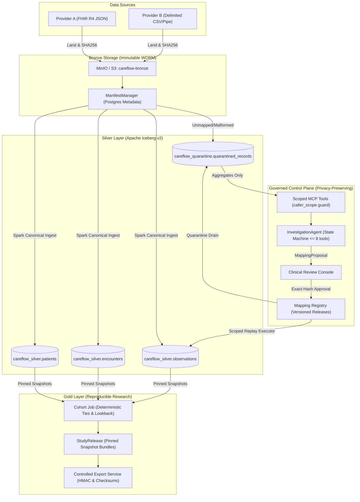

# CareFlow Atlas — End-to-End System Architecture

## 1. System Vision & Foundational Design
CareFlow Atlas is a replayable healthcare data platform with a bounded AI agent control plane designed for clinical terminology investigation, schema evolution, and reproducible observational research.

The platform resolves the fundamental tension in healthcare analytics between **rapid terminology normalization** and **strict clinical validation**:
- **Probabilistic Agent Control Plane:** Investigates unfamiliar feeds, computes safe aggregate statistics, and synthesizes DSL mapping proposals.
- **Deterministic Lakehouse Data Plane:** Executes only sandboxed allowlist operations and enforces cryptographic human approvals, atomic Iceberg v2 table commits, and duplicate-safe re-runs.

---

## 2. Architectural Tiers & Component Responsibilities

### 2.1 Storage & Catalog Architecture (Apache Iceberg v2)
- **Tables:** `careflow_silver.patients`, `careflow_silver.encounters`, `careflow_silver.observations`.
- **Partitioning:** Physical partitioning by `provider` prevents cross-provider lock contention and enforces storage separation.
- **Merge-on-Read:** Formatted as Iceberg v2 with `write.delete.mode='merge-on-read'` and `write.update.mode='merge-on-read'`.
- **Monotonic Sequence Updates:** Higher change sequence (`_change_sequence = 2`) supersedes prior records; operations with `_operation = 'delete'` set `supersession_state = 'deleted'` while maintaining row lineage.

### 2.2 Scoped MCP Tools & Control Plane Privacy
- The agent does **not** query Iceberg or Postgres directly.
- All investigation occurs through [`ScopedMCPTools`](file:///Users/dpcubed/.gemini/antigravity/scratch/careflow-atlas/services/mcp_tools/tool_server.py):
  1. `get_schema_diff`: Column additions and contract differences.
  2. `lookup_term`: Canonical catalog lookup and approved alias retrieval.
  3. `get_safe_profile`: Aggregate value distributions, format patterns, and units (`contains_phi=False`).
  4. `dry_run_mapping`: Isolated in-memory sandboxed execution.
  5. `propose_replay`: Candidate replay scoping without data mutation.
- Strict Caller Scope Check: Requests with mismatching `caller_scope != provider_id` raise `CrossProviderAccessError`.

### 2.3 Sandboxed DSL & Mapping Registry
- **Language:** Non-Turing-complete, declarative mapping AST.
- **Operations:** Restrictive allowlist (`parse_decimal`, `map_approved_code`, `convert_approved_unit`).
- **Cryptographic Binding:** Each proposal computes a deterministic SHA-256 hash across provider, source contract, target concept, operation, and terminology snapshot. Approvals must match this hash exactly.

### 2.4 Cryptographic Audit Ledger
- **Storage:** PostgreSQL `careflow_audit.chained_audit_ledger`.
- **Chaining Invariant:** $H_i = \text{SHA256}(H_{i-1} \parallel \text{canonical\_json}(\text{payload}_i))$.
- **Tamper Detection:** `verify_chain_integrity()` iterates through all sequential ledger entries to confirm zero modification, deletion, or insertion.
