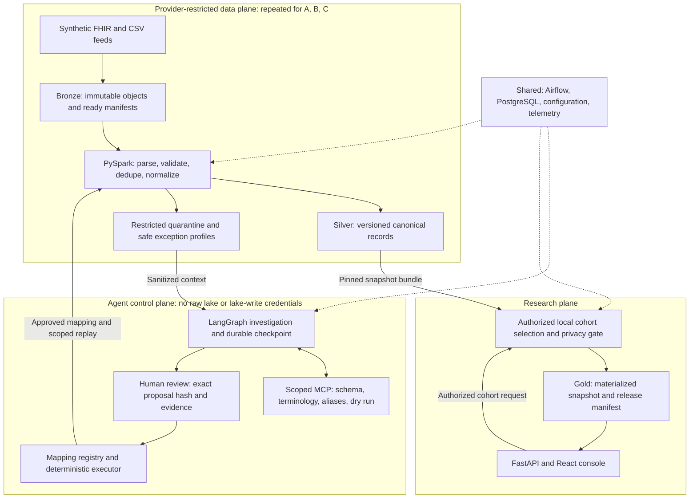

# CareFlow Atlas — Master PRD, Architecture, and Implementation Specification

**Document version:** 1.0 consolidated  
**Status:** Proposed portfolio project; not an implemented or clinically validated system  
**Audience:** Project owner, engineering reviewers, and coding agents working in Google Antigravity  
**Primary artifact:** This standalone Markdown specification  

---

## 0. How to use this document

This document merges the CareFlow Atlas product requirements, architecture, technical design, resume alignment, delivery plan, and completion addendum. It replaces the need to consult those earlier documents. It specifies intended behavior, not achieved results.

### Coding-agent operating instructions

1. Read this entire specification before selecting dependencies or generating code.
2. Treat explicit invariants, security constraints, and non-goals as binding. A model prompt is not an authorization boundary.
3. Implement the phases in order. Deliver a thin working vertical slice before expanding providers or infrastructure.
4. At the beginning of each phase, state its scope, affected contracts, expected tests, and assumptions. Do not ask the user to approve routine local code edits; do request authorization for external side effects, paid resources, real-data access, or destructive operations.
5. If repository code conflicts with this specification, identify the conflict and document the chosen resolution. Never silently weaken a requirement to make a test pass.
6. Do not invent benchmark results, clinical terminology equivalences, successful tests, API capabilities, compliance certifications, or production-scale claims.
7. Use synthetic fixtures only. Never request employer data, production credentials, or real patient records.
8. Keep Airflow, API, agent, and Spark dependencies isolated. Pin tested versions and image digests; do not depend on floating latest tags.
9. Prefer small modules, typed boundaries, explicit error classes, deterministic tests, and inspectable artifacts. Avoid unnecessary frameworks or services.
10. Do not execute generated Python, arbitrary SQL, shell commands, or arbitrary URLs through agent-facing tools.
11. For each completed phase, run the prescribed tests and report actual commands and results. If execution is unavailable, explicitly mark tests as not run.
12. Update README, implementation status, ADRs, and runbooks as behavior becomes real. Keep targets separate from measured results.
13. Do not mark the project complete while essential recovery, authorization, or release-consistency tests are missing.
14. This document contains examples and proposed interfaces. They are not a pre-existing implementation. Command names in Section 24 are interfaces to implement, not commands already verified to work.

### Requirement precedence

Security and correctness invariants take precedence over convenience, demonstration polish, latency targets, or optional features. Mandatory acceptance criteria take precedence over example implementation details. If a clinical or source-ordering assumption cannot be established, quarantine or abstain rather than guess.

### Evidence conventions

- **Requirement:** intended product behavior.
- **Target:** a proposed performance or quality objective, not a result.
- **Fixture:** synthetic/authored test content, not real-world evidence.
- **Measured result:** produced by an actual recorded execution with inputs and environment.
- **Resume achievement:** supplied by the project owner, not independently verified here.

---

## 1. Executive product definition

CareFlow Atlas is a replayable healthcare ETL platform that turns heterogeneous synthetic provider feeds into reproducible research datasets. A governed agent investigates unfamiliar terminology and schema changes, gathers evidence through scoped tools, and proposes a mapping. Human reviewers authorize exact artifacts. Deterministic services validate, transform, replay, and publish.

**Central proposition:** probabilistic investigation belongs in a bounded control plane; clinical transformation, authorization, and publication remain explicit platform contracts.

### Flagship scenario

A simulated provider changes its lab feed. The pipeline detects an unfamiliar label and malformed numeric representation, quarantines affected resources, and continues or blocks publication according to a declared quality policy. An agent investigates using schema, terminology, aliases, and a bounded dry run. A reviewer approves the exact proposal. The executor registers a mapping version, replays only affected inputs, and creates a new research release while preserving attribution of the previous release.

### Positioning

Present this as a governed data platform with an agentic control plane, not a chatbot with ETL attached. It is an original portfolio implementation aligned to the supplied Truveta data-processing role, not a reproduction of Truveta's proprietary architecture, models, vocabulary, or scale.

---

## 2. Role alignment and product value

The supplied role spans ingestion, processing, storage, serving, governance, and observability; hands-on architecture; documented decisions; build-versus-buy judgment; migrations; and reliability with regulated data. This project provides inspectable technical evidence across those areas.

| Role concern | Project demonstration | Evidence |
| :--- | :--- | :--- |
| **Full data lifecycle** | Feed to research snapshot | Recorded end-to-end execution and manifest |
| **Correctness under volume** | Stable keys, ordering, reconciliation, replay | Property tests and measured resource workloads |
| **Reliability under failure** | Restart, reconciliation, conditional publication | Fault injection and recovery runbooks |
| **Governance and privacy** | Isolation, least privilege, approval binding | Threat model and negative tests |
| **Technical strategy** | Boundaries, staged roadmap, optional-service exclusions | ADRs and decision triggers |
| **Durable architecture** | Pinned inputs and transformation versions | Reproduction of an old release after updates |
| **Reusable platform design** | Adapter and mapping contracts | Second provider without core rewrite |

*A solo project does not prove organization-wide adoption, hiring calibration, cross-geography influence, or production healthcare operations. Use the professional resume for those claims.*

### Hypothesis

A bounded investigation agent can reduce mapping-investigation effort without receiving authority to alter production semantics. Evaluate that hypothesis against rules-only and single-call baselines; do not assume the agent is valuable.

---

## 3. Users and workflows

| Persona | Need | Outcome |
| :--- | :--- | :--- |
| **Provider onboarding engineer** | Connect a feed | Versioned adapter and schema without unrelated changes |
| **Data engineer** | Explain and recover a failed run | Exact inputs, classifications, scope, and safe replay |
| **Terminology reviewer** | Assess a mapping | Candidates, provenance, units, uncertainty, impact |
| **Researcher** | Obtain an attributable cohort | Authorized immutable release and quality report |
| **Platform administrator** | Change limits safely | Audited settings, pinned runs, explicit fallback |
| **Security reviewer** | Verify enforced boundaries | API, storage, MCP, and export denial tests |

### End-to-end workflow

1. Register provider contract and ingestion identity.
2. Upload a synthetic batch, verify its content, and mark its manifest ready.
3. Parse, validate, classify, deduplicate, normalize, and persist.
4. Reconcile counts and publish a complete provider snapshot bundle if policy permits.
5. Register unresolved exceptions with safe investigation summaries.
6. Agent chooses tools, collects evidence, proposes a typed mapping or abstains.
7. Validate the proposal in a bounded deterministic dry run.
8. Human approves or rejects the exact proposal and evidence scope.
9. Executor revalidates authority and registers a mapping version.
10. Airflow launches scoped replay, followed by verification.
11. Researcher submits an authorized cohort request over pinned snapshots.
12. Release checks produce a materialized research dataset and manifest.

---

## 4. Scope, priorities, and non-goals

### P0: two-week vertical slice
- One synthetic FHIR provider.
- Patient, Encounter, Observation.
- Manifest ingestion, validation, deduplication, quarantine, canonical rows.
- One unfamiliar-lab investigation with actual tool selection.
- Typed mapping DSL, dry run, exact-hash human decision, deterministic promotion.
- Scoped replay and one asynchronous research cohort release.
- Minimal run, review, and release screens.
- Duplicate-safe replay, authorization denial, and at least one crash recovery.

### P1: full portfolio
- Three simulated feed contracts including CSV.
- Condition and MedicationRequest.
- Corrections, deletes, late arrivals, source-order conflicts, schema evolution.
- Full review console, quality dashboards, release comparison.
- Formal evaluation fixtures and three baselines.
- Multi-table fault tests, isolation tests, migration demonstration.
- Optional read-only incident agent only after core completion.

### Deferred
Live EHR/HL7 v2 integrations, DICOM, claims, genomics, full OMOP conversion, unrestricted research SQL, natural-language research assistant, multi-agent orchestration, active-active writers, model training, Kafka CDC, Kubernetes, Trino, Redis, vector databases, real PHI, compliance certification.

Cross-provider patient identity resolution is not implemented. Default populations are disjoint. Known-overlap fixtures must not support combined unique-patient claims until identity handling is designed.

---

## 5. Data fixtures and clinical boundaries

Use Synthea-generated fixtures plus controlled adapters and authored mutations. Record generator version/commit, seed, fixed reference date, configuration, adapter version, mutation version, object hashes, patient counts, and actual resource counts.

| Provider | Contract | Deliberate variation |
| :--- | :--- | :--- |
| **A** | FHIR R4 resource files/bulk NDJSON | Explicit resource references and coded observations |
| **B** | CSV from a separate synthetic population | Local terminology, renamed fields, explicit sequence |
| **C** | FHIR and optional authored notes | Ambiguous abbreviations, missing context, adversarial strings |

Start near 1,000 generated patients for development, count resulting resources, then choose the acceptance workload. A million-resource run is optional, not an assumed capability.

### Terminology
- Begin with roughly 20–50 explicitly reviewed lab concepts.
- Verify vocabulary provenance and redistribution terms before including terminology files.
- Prefer exact codes and approved aliases before invoking the model.
- Preserve original code, coding system, label, value, unit, and status.
- Missing context, incompatible units, unsupported concepts, and ambiguous equivalence remain unresolved.
- Pin terminology snapshots.
- Do not redistribute restricted terminology without confirming permission.
- Optional text extraction is review-only. Negated, hypothetical, family-history, or uncertain mentions must not become confirmed patient diagnoses.
- No treatment advice, clinical eligibility validation, or real-world population claim follows from these fixtures.

---

## 6. End-to-end architecture



Solid arrows represent data or authorized workflow actions; dashed arrows represent coordination. The agent is an asynchronous exception path, not mandatory per-record processing.

### Responsibilities
- **Data plane:** raw payloads, validation, deterministic normalization, restricted exceptions, history/current views, provider-local cohort work.
- **Control plane:** safe metadata, investigations, versioned proposals/mappings, approvals, orchestration, audit, configuration. Agents cannot read arbitrary notes or obtain write access to clinical tables.
- **Research plane:** study permissions, validated cohort DSL, release checks, materialized results, controlled downloads. Research users never query bronze/silver directly.
- **Local isolation:** separate buckets, credentials, provider catalog databases/roles, and service scope. A prefix or `provider_id` column alone is not an authorization boundary. One-host logical isolation is not production institutional isolation.

### Orchestration
Airflow owns intervals, dependencies, batch retries, and bounded replay. LangGraph owns investigation state, tool choice, evidence, abstention, and human interruption. Human review must not occupy an Airflow worker for hours.

A completed batch can have product state `COMPLETED_WITH_EXCEPTIONS` even when its orchestration tasks succeeded. Keep product state distinct from Airflow task state. Approval launches a new replay; it does not mutate a historical completed run.

---

## 7. Technology stack and compatibility

| Layer | Proposed choice | Constraint |
| :--- | :--- | :--- |
| **Fixtures** | Synthea, compatible Java runtime | Reproducible synthetic generation |
| **Services** | Python 3.11, FastAPI, Pydantic | Typed contracts |
| **Batch** | PySpark 3.5 family, compatible Java runtime | Pin tested Spark/Scala/Java/Iceberg artifacts |
| **Tables** | Iceberg format v2, Parquet | Explicit snapshot and update/delete semantics |
| **Objects** | MinIO | Development S3-compatible interface |
| **Catalog** | JDBC catalog on PostgreSQL | Provider-isolated database roles |
| **Orchestration** | Airflow 3.x | Pin constraints and compatible providers |
| **Agent** | LangGraph, PostgreSQL checkpoints | Durable bounded state machine |
| **Tools** | Authenticated MCP server | Narrow typed operations |
| **Metadata** | PostgreSQL 16 family | Ledger, approvals, audit, release pointer |
| **Research compute** | Async Spark jobs | Saved aggregates served from PostgreSQL |
| **Frontend** | React, TypeScript | Minimal evidence-oriented screens |
| **Telemetry** | OpenTelemetry, Prometheus, Grafana | Payload-free traces, bounded metrics |
| **Tests** | pytest, Hypothesis, integration containers | Unit, contract, property, security, recovery |
| **CI** | GitHub Actions | Tests, locks, secret/image/dependency scanning |
| **Deployment** | Docker Compose | Separate dependency environments |

Select exact versions in an initial compatibility spike and record a lockfile/version matrix. Match Iceberg Spark runtime to Spark minor version and Scala binary version. Verify JDBC catalog, storage credentials, Spark read/write/merge, and snapshot reads together before building features.

Do not install the whole stack into one Python image. Defer Trino until interactive query needs justify it; Kafka until an actual event adapter exists; Kubernetes until the local job contract is stable; Redis until measured caching requirements arise.

---

## 8. Storage and canonical contracts

| Layer | Contents | Access |
| :--- | :--- | :--- |
| **Bronze** | Original objects and manifests | Ingest writer; provider ETL reader |
| **Restricted quarantine** | Detailed findings and payload refs | Provider-scoped reviewer/engineer |
| **Silver** | Canonical history and current views | Deterministic ETL; local cohort worker |
| **Control** | Safe profiles, versions, proposals, decisions | Role-limited services |
| **Gold** | Released cohort objects, aggregates, manifests | Authorized study users |

### Records

- `source_manifest`: provider, feed, batch ID, source interval, object URI/hash/bytes, adapter version, readiness, delivery conflict/disposition.
- `resource_envelope`: provider, source system, resource type, source resource ID, opaque source version, adapter-established change sequence, operation, event time, ingestion time, payload URI/hash.
- `pipeline_run`: run ID, manifest digest, pinned schema/mapping/config/code versions, expected output scope, attempt, state, error class, committed snapshots.
- `canonical_observation`: provider-scoped patient/encounter/source keys, sequence, effective time, original coding/text/value/unit/status, normalized concept/value/unit, mapping reference, normalization version, lineage, supersession/deletion state.
- `mapping_proposal`: ID/hash, source scope, typed DSL, candidates, terminology snapshot, evidence refs, safe test results, prompt/model versions, disposition.
- `approval`: proposal hash, authorized reviewer, provider/scope, evidence version, expected registry version, expiry, decision, timestamp.
- `study_release`: release/study IDs, owner, cohort digest, fixed reference date, provider/table snapshot bundle, quality/privacy versions, code digest, output checksums, active/revoked state.
- `audit_event`: actor/service, action/resource/scope, outcome, correlation ID, old/new version, timestamp. No raw patient payloads.

### Source ordering
Logical resource key: `(provider, source system, resource type, source resource ID)`. Keep `source_version` opaque. Do not assume FHIR version strings are numeric or chronologically sortable.

Controlled fixture adapters attach a monotonic sequence per resource. A live adapter would need a documented ordering/delete contract. Ambiguous or incomparable changes are quarantined, not ordered by arrival time.

Store history by resource and accepted sequence; derive current state from the latest accepted change. Preserve normalization versions for attribution.

### Conservation
At parsed-resource-envelope granularity:
$$\text{N\_input} = \text{N\_accepted} + \text{N\_duplicate} + \text{N\_quarantined} + \text{N\_intentionally\_excluded}$$

Each resource has one disposition and potentially multiple findings. Account for unreadable files at manifest level; never invent parsed-resource counts.

---

## 9. ETL and publication semantics

### Landing
Create pending manifest; upload to staging; verify bytes/checksum; mark ready. Consumers discover ready manifests only. Same batch ID/hash is duplicate; same ID/different hash is conflict.

Object writes and metadata updates are not a distributed transaction. Reconcile abandoned objects, missing objects, and incomplete ready transitions.

### Transformation
1. Load exact ready manifests and pinned versions; never mutable latest inputs.
2. Parse provider contract and resource references.
3. Validate identity, types, timestamps, numeric representation, status, references, operations.
4. Classify accepted changes, duplicates, quarantine, explicit exclusions.
5. Apply exact codes/approved aliases and explicitly approved compatible unit operations.
6. Preserve original fields and write canonical history/current changes.
7. Validate reconciliation, uniqueness, references, and quality gates.
8. Commit snapshots and publish a complete provider bundle only when required checks pass.

Use orchestration messages for small IDs and object references only, not payloads/data frames. Do not base critical computation on wall-clock now; use pinned reference dates and data intervals.

### Write model
Deduplicate incoming changes before deterministic MERGE. Same accepted resource sequence does not create another logical current row. Delivery is at least once with duplicate-free logical state under the documented contract; do not claim end-to-end exactly once or byte-identical Parquet output.

Serialize writers per provider/resource scope in the MVP. Confirm failed workers are terminated before replacement. Expiring locks alone are not a fenced active-active protocol.

### Multi-table release
A table commit is not a transaction across clinical tables. Record each required snapshot ID, validate the bundle, write a release manifest, then conditionally update its active pointer. Readers resolve one manifest and read its pinned bundle, never each table's latest state.

### Crash reconciliation
| Failure | Recovery |
| :--- | :--- |
| **Upload complete, manifest pending** | Verify and finalize or remove staging |
| **Before table commit** | Retry same pinned inputs |
| **Commit succeeds, ledger update lost** | Inspect snapshot/run metadata; reconcile before retry |
| **Some tables committed** | Keep previous complete release active |
| **Manifest exists, pointer unchanged** | Resume conditional publication |
| **Pointer updated, response lost** | Return existing release for idempotency key |

### Replay/migration
Replay specifies manifests, provider, resource types, dependency closure, source/destination mapping version, and expected output scope. Mapping changes affect necessary resources and derived cohorts, not unrelated providers.

Incompatible schema changes use new version, shadow transformation, counts/digests/quality comparison, then pointer switch. Rollback selects a valid complete release. Do not erase old interpretations or blindly rewrite history.

---

## 10. Functional requirements

| ID | Requirement | Acceptance |
| :--- | :--- | :--- |
| **FR-01** | Extensible adapter | Add second provider without canonical-core rewrite |
| **FR-02** | Verified immutable input | Duplicate/conflict behavior is correct |
| **FR-03** | Supported resource parsing | Paired FHIR/CSV fixtures yield equivalent fields |
| **FR-04** | Provenance | Every canonical result links to input and transform |
| **FR-05** | Safe quarantine | Attributable findings and declared partial-release behavior |
| **FR-06** | Corrections/deletes | Ordering permutations converge |
| **FR-07** | Bounded investigation | Typed proposal or explicit abstention |
| **FR-08** | Governed promotion | Role/hash/expiry/staleness checks enforced |
| **FR-09** | Safe replay | Stable logical counts/content digest |
| **FR-10** | Complete releases | No visibility before mandatory gates |
| **FR-11** | Provider isolation | API/object/MCP cross-scope requests denied |
| **FR-12** | Reproducibility | Retained release has stable manifest/checksums |
| **FR-13** | Explainable runs | Timings, attempts, errors, affected scope visible |
| **FR-14** | Pinned configuration | New settings do not mutate in-flight runs |
| **FR-15** | AI outage tolerance | Known mappings process; novel cases unresolved |

---

## 11. Agent specification

### Objective and boundaries
Determine whether an unfamiliar source term/schema can be mapped using available evidence; otherwise abstain with missing information. Fixed parsing, validation, unit checking, and known mappings remain deterministic.

The model may select an investigation path. It may not approve mappings, weaken gates, obtain credentials, write tables, or execute arbitrary code. Every new semantic mapping requires human review in MVP, irrespective of self-reported confidence. Approved versions are reused deterministically without per-record model calls.

### State machine
`NEW` $\to$ `COLLECT_EVIDENCE` $\to$ `SELECT_TOOL` $\leftrightarrow$ `EXAMINE_RESULT` $\to$ `PROPOSE_TYPED_MAPPING` $\to$ `VALIDATE_DRY_RUN` $\to$ `AWAIT_HUMAN`.

- **Review outcomes:** `REJECTED`; `REVALIDATE` if stale; `READY_FOR_EXECUTOR` if valid approval.
- **Execution:** `PROMOTED` $\to$ `SCOPED_REPLAY` $\to$ `VERIFIED`.

Any investigation can end in `ABSTAIN`, `BUDGET_EXCEEDED`, or `TERMINAL_FAILURE`. Persist stable thread identity from provider/exception/evidence versions. Keep checkpoints free of restricted payloads.

### Tools
| Tool | Input/output | Enforcement |
| :--- | :--- | :--- |
| `get_schema_diff` | Contract versions $\to$ typed diff | Server-side provider scope |
| `lookup_term` | Safe term, vocabulary/version $\to$ candidates/provenance | Pinned local vocabulary; no arbitrary URL |
| `get_approved_aliases` | Provider/family/registry $\to$ reviewed aliases | Explicit scope |
| `get_safe_profile` | Exception ref $\to$ types/units/aggregate findings | No unrestricted row-return path |
| `dry_run_mapping` | Proposal/sample refs and limits $\to$ report ref | Fixed DSL interpreter, isolated worker |
| `get_validation_summary` | Report ref $\to$ safe findings/impact | No raw payload |
| `propose_replay` | Approved proposal/scope $\to$ plan | Plan only; cannot execute |

Authenticate caller scope independently of model arguments. Changing `provider_id` in a tool request cannot expand authority.

### Mapping DSL example
```json
{
  "proposal_type": "observation_mapping",
  "provider_id": "provider-b",
  "source_contract_version": "lab-feed-v2",
  "match": {"local_test_code": "LOCAL_LAB_017"},
  "target_concept_ref": "reviewed-catalog/concept-017",
  "value_operation": "parse_decimal",
  "source_unit": "mmol/L",
  "target_unit": "mmol/L",
  "terminology_snapshot": "catalog-v1",
  "disposition": "requires_review"
}
```
Illustrative contract only, not a real clinical equivalence. Allowlist operations such as `rename_field`, `parse_decimal`, `map_approved_code`, `convert_approved_unit`. No generated Python or free-form SQL.

### Approval
Bind full artifact hash, provider/source scope, evidence/terminology versions, expected registry version, authorized reviewer/role, expiry, decision. Modified content, stale registry/evidence, or expiry requires revalidation. Approval registration and executor action are separate idempotent operations. Resuming a workflow must not duplicate side effects.

### Initial reliability budgets
| Control | Proposed starting value |
| :--- | :--- |
| **Tool calls** | 8 maximum |
| **Lookup timeout** | 5 seconds |
| **Dry run timeout** | 30 seconds |
| **Model call timeout** | 30 seconds |
| **Investigation wall time** | 120 seconds excluding review |
| **Retries** | Up to 2 for transient errors; backoff and jitter |
| **Terminal errors** | Auth denial, invalid DSL, unsupported terminology |
| **Approval lifetime** | Initially 24 hours, version revalidation required |
| **Spend** | Per-investigation/provider-day hard budgets |

Avoid nested unbounded retries. Record calls, timing, error class, model identifier/settings, prompt version, tokens, and actual cost when available. Limits enforced in code, not only prompts.

### Optional incident agent
Read safe run metadata and selected runbook fragments; cite actual run IDs, errors, and metrics; propose a replay plan. It cannot change thresholds, grant permissions, promote mappings, or execute recovery without separate authorization.

---

## 12. Research workflow and APIs

### Cohort DSL
Implement adults as of a fixed reference date, an approved condition-code set, and latest eligible lab in an explicit lookback window. Specify eligible statuses, canonical units, effective-time ordering, deterministic ties, missingness, corrections, entered-in-error records, and protocol-provided threshold. No clinical recommendation is implied.

$$\text{Authorize} \to \text{validate DSL} \to \text{pin reference date/terminology/policy} \to \text{resolve provider bundles} \to \text{local selection} \to \text{release checks} \to \text{materialize checksummed output/manifest} \to \text{serve permitted aggregates/download.}$$

Cohort computation is asynchronous. Saved metadata/aggregate read latency is distinct from Spark job completion and cold start.

### API contracts
| Endpoint | Behavior | Guard |
| :--- | :--- | :--- |
| `POST /providers/{id}/batches` | Register batch | Ingest scope/idempotency |
| `GET /runs/{id}` | Safe status/lineage | Run/provider access |
| `GET /mapping-proposals/{id}` | Proposal/evidence | Reviewer scope |
| `POST /mapping-proposals/{id}/decisions` | Approve/reject | Exact hash/role/expiry/version |
| `POST /replays` | Bounded replay | Operator and approved plan |
| `POST /studies` | Async cohort | Study scope/validated DSL |
| `GET /studies/{id}` | Job polling | Authorized collaborator |
| `GET /releases/{id}/manifest` | Reproducibility | Release access |
| `POST /releases/{id}/exports` | Controlled export | Fresh auth/revocation check |

Use idempotency keys for mutations and explicit conflict/error responses. In MVP serve exports through authorization gateway. Presigned URL extension must disclose expiry/revocation limitations.

### UI
Pipeline overview; run detail; exception queue; proposal diff/evidence/validation and decision; cohort job; release lineage/comparison. Show original-versus-normalized changes only to authorized reviewers. All protections must hold without the UI.

---

## 13. Privacy, security, retention

This is a synthetic-data privacy-control demonstration, not HIPAA-certified, regulatory-grade, or a proven de-identification system. Hashing/redaction alone does not establish compliance.

Release profile: remove direct identifiers; allowlist structured fields; exclude free text; apply documented patient-level generalization/suppression. A toy minimum group size of 5 may exercise controls but is not asserted to be legally sufficient. Count distinct patients, not encounters. Repeated-query inference, linkage, attribute disclosure, differential privacy, and expert risk determination are outside MVP.

| Threat | Control | Proof |
| :--- | :--- | :--- |
| **Cross-provider read** | Separate scoped credentials/roles | API/object/MCP negative tests |
| **Prompt injection** | Data treated as untrusted; narrow tools | Adversarial fixtures gain no capabilities |
| **Telemetry leak** | Allowlisted payload-free attributes | Canary scan of logs/traces/checkpoints |
| **Forged scope** | Downstream auth independent of arguments | Denial test |
| **Approval substitution** | Hash/scope/version/expiry binding | Mutation test |
| **Generated-code execution** | Fixed DSL interpreter | Unsupported-operation rejection |
| **Export leak** | Gateway, access and revocation checks | Restricted download denial |
| **Secrets** | No committed tokens; secret mechanism | CI scanning |
| **Dependency drift** | Locks, image digests, scanning/SBOM | Rebuild and reviewed updates |

Deletion removes future current visibility, identifies affected releases, and can revoke future gateway access. It cannot recall downloaded files. Historical snapshots/backups may retain content until explicit retention and cleanup. Document bronze, snapshot, research-release, audit, and backup retention. Never equate current-view absence with complete physical erasure.

---

## 14. Configuration, governance, ADRs

Resolve `cluster` $\to$ `environment` $\to$ `provider`. Deep-merge dictionaries, override scalars, merge lists only through documented identifier keys. Pin resolved version per run. Live refresh affects new runs only.

Last-known-good fallback is allowed for non-security operational settings. Missing authorization or mandatory release policy fails closed. Provider overrides cannot expand scope or disable required review.

### Required ADRs:
1. Airflow datasets versus LangGraph investigations.
2. Deterministic mapping reuse versus per-record inference.
3. Iceberg/JDBC catalog versus plain Parquet publication.
4. Reviewed DSL versus generated executable code.
5. Bundle manifest because commits are not multi-table transactions.
6. Batch-first; Kafka/Kubernetes/Trino deferred.
7. Provider isolation and query-time release.
8. Single-writer limits and failover requirements.
9. Shadow migration and rollback strategy.

Each ADR records context, alternatives, decision, consequences, rejected trade-offs, and measurable reconsideration trigger.

---

## 15. Observability and operational artifacts

Correlate `manifest` $\to$ `run` $\to$ `exception` $\to$ `investigation` $\to$ `proposal` $\to$ `mapping` $\to$ `replay` $\to$ `release`. Use identifiers in traces/logs, not unbounded Prometheus labels. No patient identifiers or raw payloads in telemetry.

Track input/disposition reconciliation, source-event freshness versus landing age, stage time, resource throughput, output bytes, shuffle/spill, replay scope, tool timeouts/retries, abstention, approval wait, token/cost, and release impact.

Dashboards: pipeline health, data quality, agent reliability, research releases.  
Runbooks: stuck manifest; catalog failure; partial commit; duplicate/conflicting delivery; stale approval; model outage; replay; rollback; release revocation; retention cleanup.

---

## 16. Evaluation and targets

All values are proposed acceptance goals, not measured outcomes.

| Dimension | Target | Measurement |
| :--- | :--- | :--- |
| **Accounting** | 100% attributable dispositions | Fixed manifests and counts |
| **Replay** | Zero extra logical current rows | Keys/counts/canonical digest |
| **Ordering** | All defined fixtures converge | Permutations/property tests |
| **Publication** | No partial bundle exposed | Fault between commits/pointer |
| **Security** | Defined bypass tests denied | Integration suite, not universal proof |
| **Lineage** | Every release attributable | Manifest validation |
| **Throughput** | Initial goal: 100,000 resources within 10 min | Documented 8-vCPU/32-GB allocation, at least 5 runs, AI excluded |
| **Metadata reads** | Initial p95 under 500 ms at 10 clients | Fixed loaded payload/service-ready environment |
| **Cohort job** | Initial goal under 60 sec on acceptance fixture | Report cold/warm separately |
| **Investigation** | Initial p95 under 120 sec, review excluded | At least 50 runs including timeout outcomes |
| **Promotion** | Zero unapproved new mappings | Audit assertions |
| **Mapping conformance** | Initial goal 95% correct among proposals | Bounded held-out cases, coverage/uncertainty reported |

Publish misses and bottlenecks. No synthetic benchmark establishes real clinical accuracy or production scalability.

### Agent experiment
Version approximately 200 authored/perturbed cases: exact terms, aliases, ambiguity, incompatible units, missing context, schema changes, and injection. Split by concept/alias family; hide answers from model/tools/retrieval.

Compare rules-only, one structured model call, and tool-using agent with equivalent terminology access where possible. Measure precision among proposals, coverage, abstention, unsupported codes, reviewer rejection, tool failure, latency, and cost. Without expert review use fixture-conformance terminology. Report sample size and uncertainty; self-confidence is not calibrated probability.

---

## 17. Test and failure matrix

| Scenario | Required behavior |
| :--- | :--- |
| **Same manifest three deliveries** | One accepted logical delivery |
| **Batch ID with changed bytes** | Visible conflict |
| **Correction before original** | Latest valid sequence current |
| **Delete then old version** | No resurrection |
| **Incomparable versions** | Quarantine/conflict |
| **Kill after commit** | Reconcile ownership, avoid duplicate application |
| **Fail between table commits** | Prior complete release active |
| **Add nullable field** | Versioned compatible evolution |
| **Numeric changes to incompatible text** | Quarantine/block by policy |
| **Model outage** | Known mappings proceed |
| **Inject label/note instructions** | No new action capability |
| **Restart during review** | Resume exact thread safely |
| **Repeat approval** | One promotion/idempotency |
| **Modify approved proposal** | Hash mismatch denied |
| **Cross-provider tool request** | Downstream denial |
| **Rare patient group** | Suppress/generalize/refuse |
| **Missing security policy** | Fail closed |
| **Snapshot expiration** | Explicit limitation; never substitute latest silently |
| **Lost publication response** | Same idempotency key returns prior release |

Test levels: unit functions; contract schemas; Hypothesis invariants; integration with actual catalog/object store; end-to-end product flow; negative auth; fault injection; baseline evaluation; reproducibility rebuild.

---

## 18. Resume-to-feature mapping

Based on supplied resume only. No employer code or proprietary artifacts.

| Achievement | Feature | Inspectable artifact |
| :--- | :--- | :--- |
| **LangGraph/MCP hardening** | Bounded investigation | Timeouts/retry taxonomy/restart/tool tests |
| **Runtime configuration across AI products** | Provider policy service | Merge/pinning/fallback/audit tests |
| **Configuration library discovery and merging** | Typed config registry | Explicit keyed-list/dictionary/scalar contracts |
| **Airflow migration and Spark infrastructure** | Versioned batch execution | Compatibility matrix and migration ADR |
| **JDK/Scala cross-repo upgrades** | Dependency isolation | Locked compatible artifacts/images |
| **OAuth integrations/GovCloud/security remediation** | Least-privilege identities | Threat model and negative authorization |
| **Records API async/auth/file delivery** | Research API and export | Polling/idempotency/access tests |
| **Tenant decommissioning idempotency** | Safe replay | Duplicate/crash/lost-response proof |
| **Connector framework** | Provider adapter SDK | Second adapter without core rewrite |
| **OpenTelemetry and monitoring standards** | End-to-end correlation | Investigation-to-release trace |
| **Multi-source GCP ingestion** | FHIR/CSV normalization | Paired controlled fixture equivalence |
| **Kafka/Java analytics and performance** | Source ordering and workload study | Property tests and measured report |
| **Healthcare application work** | Clinical-status/ambiguity boundaries | Negation/missingness/unit tests |
| **Security product engineering** | Enforced tool boundaries | Injection/bypass-denial tests |
| **Mentoring/hiring/platform leadership** | Handoff/governance package | Guides, review rubric, ADRs, runbooks |
| **MBA/business context** | Scope and cost decisions | Build-versus-buy and cost per approved mapping |

---

## 19. Delivery roadmap

Planning assumption: roughly six weeks at 20–25 hours/week with familiarity in selected tools. Revise estimates after Phase 0.

| Phase | Planned timing | Deliverable and gate |
| :--- | :--- | :--- |
| **0** | Beginning of week 1 | Compatible locked stack; ingest/write/merge/snapshot smoke test |
| **1** | Week 1 | One provider to versioned cohort; duplicate-safe replay |
| **2** | Week 2 | Agent tools $\to$ proposal $\to$ review $\to$ replay $\to$ new release |
| **3** | Week 3 | CSV, corrections/deletes, drift, second adapter |
| **4** | Week 4 | Isolation, artifact approval, controlled export, console |
| **5** | Week 5 | Recovery, evaluation, benchmarks, migration |
| **6** | Week 6 | ADRs, runbooks, reproducibility package, recording |

If constrained, drop incident agent, free-text extraction, third provider, and optional infrastructure before recovery or authorization tests. Week 2 must demonstrate the complete product loop.

---

## 20. Repository layout

```
careflow-atlas/
apps/
  api/
  console/
services/
  agent/
  mcp-tools/
  mapping-executor/
  release-service/
pipelines/
  dags/
  spark/
  adapters/
packages/
  contracts/
  configuration/
  mapping-dsl/
  telemetry/
fixtures/
  generation/
  mutations/
evaluations/
  cases/
  baselines/
tests/
  unit/
  contracts/
  integration/
  properties/
  security/
  recovery/
  e2e/
infrastructure/
  compose/
docs/
  master-spec.md
  implementation-status.md
  architecture.md
  adr/
  threat-model.md
  runbooks/
  benchmark-methodology.md
README.md
Makefile
```

Keep this master specification authoritative; architecture/runbooks can extract implementation details without silently conflicting with it.

---

## 21. Suggested implementation backlog

| Work item | Dependency | Done when |
| :--- | :--- | :--- |
| **Typed contracts/error model** | None | Serialization/validation/conflict tests |
| **Auth context/provider scopes** | Contracts | Cross-scope denial before tools |
| **Ready manifest protocol** | Contracts/auth | Duplicate/conflict/reconciliation tests |
| **FHIR adapter** | Manifest | Supported resources parse with provenance |
| **Canonical Spark job** | Adapter/catalog smoke test | Reconciliation and stable logical state |
| **Bundle publication** | Canonical job | Partial failure never exposed |
| **Cohort DSL/job** | Bundle | Fixed reference and deterministic ties |
| **Mapping DSL/registry** | Contracts/auth | Unsupported ops denied; versions pinned |
| **Safe MCP tools** | Registry/profile | Scoped inputs/outputs and timeouts |
| **Agent state machine** | Tools | Tool choice, abstention, persistence |
| **Review/executor** | Agent/registry | Exact approval and replay idempotency |
| **Research release/export** | Cohort/auth | Policy gates and authorized gateway |
| **CSV/updates/deletes** | Stable core | Adapter/order property tests |
| **UI** | Stable APIs | Evidence visible without bypassing auth |
| **Recovery/evaluation** | Full slice | Actual recorded test results |

---

## 22. Interview and portfolio package

Ten-minute demo:
1. State invariant: no unreviewed semantic mapping reaches a release.
2. Ingest a clean batch.
3. Introduce unfamiliar lab label.
4. Show quarantine and exact affected scope.
5. Show agent selecting tools and evidence.
6. Approve exact proposal.
7. Replay only affected observations.
8. Compare old/new release manifests and results.
9. Repeat replay to prove logical idempotency.
10. Show crash recovery and unauthorized-request denial.

Suggested positioning: “This separates probabilistic investigation from deterministic execution. The agent gathers evidence and proposes mappings; authorization, validation, transformation, and publication stay explicit through retries and failures.”

Publish architecture, README, fixture provenance, threat model, ADRs, measured benchmark methodology/results, evaluation, recovery transcript, demo recording, limitations. A dashboard alone is insufficient.

---

## 23. Definition of done

- One-command local setup and documented hardware/dependency prerequisites.
- Reproducible synthetic fixtures with provenance and actual resource counts.
- Complete ingest $\to$ investigate $\to$ approve $\to$ replay $\to$ research flow.
- Contracts and invariants enforced by code, not prompt text.
- Duplicate/correction/delete behavior and complete release publication proven.
- Agent restarts and model outage handled safely.
- Authorization, approval substitution, and injection tests pass.
- Baselines and costs measured honestly; unavailable execution marked not run.
- Historical-release retention/reproducibility limitations documented.
- No real PHI, employer data, hardcoded secrets, or unsupported clinical/compliance claims.
- Compatible locked build, CI, runbooks, ADRs, demo, and status document.
- Scope differences and deferred features explicitly recorded.

---

## 24. Coding-agent phase handoff

Implement a proposed local interface such as:
```bash
make bootstrap
make up
make fixtures
make smoke
make test-unit
make test-contracts
make test-integration
make test-security
make test-recovery
make demo
make down
```

These command names are proposed deliverables, not existing verified commands. Bootstrap must document downloads/network needs and never hide paid/cloud provisioning. Teardown must not delete volumes unless an explicitly named destructive target is confirmed by the operator.

### First coding-agent task:
> "Read this specification. Inspect the repository. Produce a concise Phase 0 plan and explicit compatibility assumptions, then implement only the contracts, local infrastructure, and a minimal write/merge/snapshot smoke test. Do not add optional services. Record actual execution evidence and unresolved risks before moving to Phase 1."

At each handoff report:
- completed requirement IDs;
- changed files/contracts;
- commands run;
- passed/failed/not-run tests;
- known limitations;
- next phase.
Never declare production readiness from a local demo.
